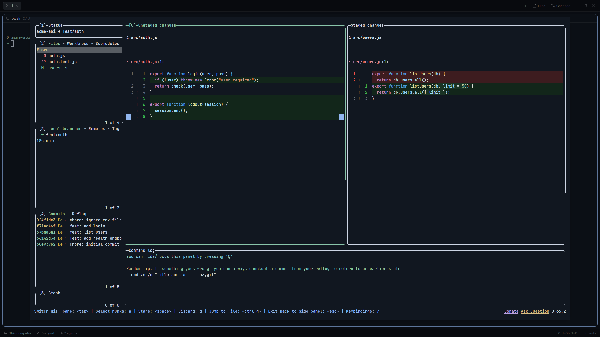

# lazygit for Herdr

A [Herdr](https://herdr.dev) desktop app mod that opens [lazygit](https://github.com/jesseduffield/lazygit) in a floating dialog, for the git repo of the terminal you are in. Press `ctrl-shift-g` to show it, press again to hide it. lazygit keeps running, so it comes back as you left it.



- **Follows your focus.** Opens lazygit in the repo root of the focused terminal, even from a subfolder.
- **One lazygit per repo per space.** Hiding and showing reuses the same lazygit.
- **Remote machines too.** Works in spaces on another Linux or macOS machine (`hc machine`), when that machine has `git` and `lazygit`.
- **Stays out of the way.** `Esc` goes to lazygit, not Herdr. Click outside the dialog to hide it. `q` in lazygit quits it and closes the dialog.
- **Cleans up after itself.** Ends lazygits whose space was closed, and those hidden for 30 minutes or more.
- **Clear errors.** Shows a notification when the folder is unknown, is not a git repo, or lazygit is missing.

## Install

You need Herdr app 0.1.12 or newer, and `git` and `lazygit` on each machine you use it on.

Clone this repository and link the mod into Herdr's home, so a `git pull` updates it:

```sh
git clone https://github.com/Nico-Mayer/lazygit-herdr.git
ln -s "$PWD/lazygit-herdr/mods/lazygit" ~/.config/herdr-app/mods/lazygit
```

On Windows (PowerShell):

```powershell
git clone https://github.com/Nico-Mayer/lazygit-herdr.git
New-Item -ItemType Junction -Path "$HOME\.config\herdr-app\mods\lazygit" -Target "$PWD\lazygit-herdr\mods\lazygit"
```

Then merge [`keys.json`](keys.json) into `~/.config/herdr-app/keys.json`:

```json
{
  "global": { "ctrl-shift-g": "mod.open:lazygit" },
  "terminal": { "ctrl-shift-g": "mod.open:lazygit" }
}
```

Keep both sections. The `terminal` entry lets the key hide lazygit while lazygit has focus. To use another key, change it in both. Avoid keys lazygit uses, and `ctrl-alt-*` on Windows (it acts as AltGr).

## Settings

Optional. Without settings, the mod finds `lazygit` on each machine's `PATH`. To point it at a specific binary, create `~/.config/herdr-app/lazygit.json`:

```json
{
  "path": "/usr/local/bin/lazygit",
  "machines": {
    "my-server": "/home/me/.local/bin/lazygit"
  }
}
```

- `path`: lazygit on this computer.
- `machines`: lazygit per remote machine, by its name in `hc machine ls`.

The file is read on each press. This helps when lazygit is on `PATH` only as a shim (for example from mise), which can slow down each start.

## What it runs

On the machine of the focused space, the mod runs `git rev-parse` to find the repo root, and `where.exe` or `command -v` to find lazygit (once per machine, then remembered until Herdr restarts or a start fails). It starts lazygit as a labeled herdr-core terminal (`hc run`), lists its own terminals (`hc ls`) and ends them during cleanup (`hc kill`). It reads `lazygit.json` from Herdr's home. The mod itself makes no network requests.

Cleanup only runs when you press the key, after the dialog shows, and skips machines that are offline or still loading.

## Development

```sh
npm test        # unit tests for mods/lazygit/model.js
npm run check   # herdr-app check mods/lazygit
```

With the mod linked as above, saving a file reloads it.

## License

[MIT](LICENSE). [RECIPE.md](RECIPE.md) is the brief to build it from scratch.
