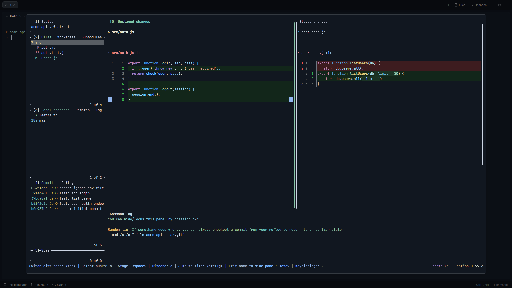

# lazygit

Press `ctrl-shift-g` and lazygit opens in a large floating dialog over the Herdr window, in the git repo of the focused terminal. Press it again, or click outside, and the dialog hides while lazygit keeps running. The next press shows the same lazygit.

## What you see

- A Herdr dialog, 90% of the window wide and high, centered, with Herdr's dialog look. No title bar, cannot be dragged.
- Inside it, one terminal running lazygit, filling the whole dialog.
- Nothing else: the mod adds no sidebar entry, button or tab.
- When something is wrong, a Herdr notification instead of the dialog:
  - warning "No active pane": no focused terminal.
  - warning "Folder unknown": the focused terminal has no known folder.
  - warning "Not a git repo": `<cwd> is not inside a git repository.`
  - error "git not installed" or "lazygit not installed" (the second one mentions `lazygit.json`).
  - error "`<command>` failed on `<machine>`": a remote machine is offline or lacks the program.
  - error "lazygit settings": `lazygit.json` is not valid.
  - error "lazygit did not start": a path set in `lazygit.json` failed to start.

## How it behaves

- **Press (nothing shown):** find the repo root of the focused terminal's folder (`git rev-parse --show-toplevel`). Reuse the lazygit already running for that repo in this space, or start a new one there. Show it in the dialog. lazygit gets keyboard focus.
- **Press (dialog shown):** hide the dialog, give focus back to the pane that had it before.
- **Click outside, or a layout switch:** hides the dialog the same way; the next press opens it again.
- **Esc** goes to lazygit, not Herdr.
- **`q` in lazygit:** lazygit exits, its terminal is removed, the dialog closes.
- **One lazygit per repo per space.** Two spaces on the same repo get two lazygits.
- **Remote spaces:** for a space on another machine (`hc machine`), git and lazygit run on that machine.
- **Cleanup on every press:** ends this mod's lazygits whose space was closed, and those hidden for 30 minutes or more. Skips machines that are not ready. Only runs on a press, so a hidden lazygit can outlive 30 minutes until the next one.
- **Settings:** optional `~/.config/herdr-app/lazygit.json`, read on each press:
  `{ "path": "<lazygit on this computer>", "machines": { "<name in hc machine ls>": "<path>" } }`. Without it, lazygit is found on `PATH`.

## Built from

- `mods/lazygit/mod.json`: `{"place":"none","title":"lazygit","overlay":{"kind":"window","frame":"none","width":1,"height":1}}`.
- `keys.json`: `ctrl-shift-g` -> `mod.open:lazygit` in both `global` and `terminal` sections.
- **Runner copy.** `mod.open` opens a 1x1 invisible copy. Its `init` spawns one toggle, then `closeOverlay(props().overlay)`. It renders an empty `div()`.
- **Process state** on `globalThis.__lazygit_float_v1`: the shown dialog `{overlay, terminal, previousPane}`, a lease `{owner, at}`, and `paths` (found lazygit path per machine). Each runner waits for the lease (expires after 15 s), so a fast double press runs two toggles in order. The runner also releases the lease in `close()`.
- **Durable state** in `shared("lazygit.v1")`: `{ hiddenAt: { <terminal address>: <ms> } }`. Written only when it changes: `setShared` saves to disk and re-renders every mod.
- **Dialog:** `openOverlay({kind:"dialog", width:0.9, height:0.9, layout:{type:"column", children:[{type:"block", size:{px:0}, content:{mod:"lazygit", props:{role:"sentinel", terminal}}}, {type:"block", content:{terminal}}]}})`. The 0px sentinel copy's `close()` runs however the dialog goes: it clears the shown-dialog record and sets `hiddenAt`.
- **Hide:** `closeOverlay` (the sentinel sets `hiddenAt`), `run("pane.focus", {pane: previousPane})`, then cleanup.
- **Open:** in parallel, list instances and locate the target. Locate uses `focused()`, `spaces()` (the space's `machine`, null for this computer), `readTextFile(appHome() + "/lazygit.json")` and `exec("git", ["-C", cwd, "rev-parse", "--show-toplevel"], {on: machine})`. Then reuse or start, show, and only then cleanup, so slow remote kills do not delay the dialog. If locate fails, cleanup runs before the notification.
- **Find lazygit** only when starting: the configured path, else `where.exe lazygit` on local Windows, else `sh -c "command -v lazygit"`. First non-empty line. The found path is cached per machine, and dropped when a start with it fails.
- **Start:** `hc run --json --bg --rm --no-parent [--on <machine>] --cwd <root> --label herdr.mod=lazygit --label lazygit.repo=<root key> --label lazygit.space=<space id> -- <lazygit>`. Returns the address (`tN`, or `machine/tN` for remote).
- **List:** `hc ls --json --label herdr.mod=lazygit`, then `hc get --json <address>` for each to read labels and state.
- **Repo key:** backslashes to `/`, trailing slash removed, lowercased only for local Windows.
- **Cleanup** (`planCleanup`, pure): for live terminals labeled `herdr.mod=lazygit` and without a `herdr.space` label. Machine = address prefix before `/`, none for local. Machine not `layout === "ready"` in `machines()`: skip, keep its `hiddenAt`. `lazygit.space` not in `spaces()` (and `spaces()` not empty): `hc kill`. The terminal about to show: keep. No `hiddenAt`: set it to now. Hidden 30 min or more: `hc kill`.
- Pure logic (`normalizeRoot`, `firstLine`, `findInstance`, `planCleanup`, `parseSettings`, `executableFor`) lives in `model.js` with `node --test` unit tests. Herdr calls live in `main.js`.

## Watch out

- Mods only run while shown. A background copy cannot receive a named command, so the key must use `mod.open` with a self-closing runner.
- `kind:"window"` overlays do not take the keyboard, and `pane.focus` cannot focus a terminal inside an overlay. Use `kind:"dialog"`.
- `focused()` and `herdr-app status` do not report focus inside overlays. Check focus by hand.
- The `terminal` section in `keys.json` is needed, or the key goes to lazygit while it has focus.
- `--no-parent` is needed, or lazygit dies with the shell it was started from. `--rm` removes it when lazygit quits.
- A mise shim on Windows adds about 2 s to each start. Setting the real path in `lazygit.json` avoids it.
- Remote Windows machines are not supported: the remote lookup uses `sh`.
- No `ctrl-alt-*` keys: on Windows they act as AltGr.
- A mod reload calls the sentinel's `close()` while the dialog may still show. Only matters during development.

## Done when

- `herdr-app check mods/lazygit` reports no errors.
- In a terminal inside a git repo, `ctrl-shift-g` shows lazygit for the repo root, and typing goes to lazygit.
- `ctrl-shift-g` again hides it and focus returns to the terminal. A third press shows the same lazygit (same `hc ls` address).
- Clicking outside the dialog hides it, and the next press shows it again.
- `q` in lazygit closes the dialog, and `hc ls --json --label herdr.mod=lazygit` no longer lists it.
- In a folder outside any repo, the press shows "Not a git repo" and no dialog.
- Two spaces on the same repo get two different addresses.
- After closing a space, the next press ends that space's lazygit.
- In a space on a remote machine, lazygit runs there (`machine/tN` address).
